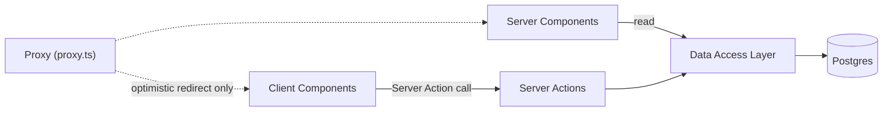
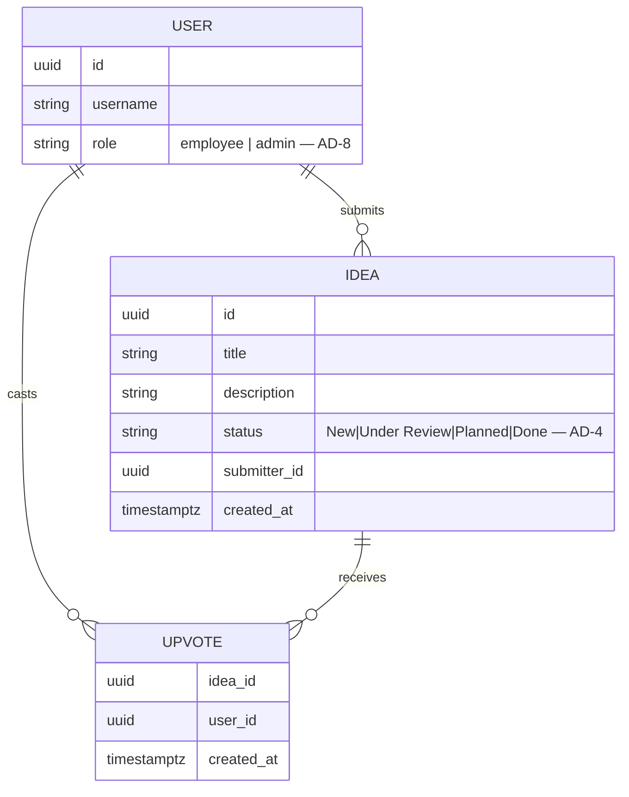

# Architecture Spine — TeamPulse

## Design Paradigm

**Layered architecture**, following the Next.js App Router's own recommended shape rather than inventing one:

`Presentation (Server/Client Components)` → `Server Actions (mutation boundary)` → `Data Access Layer — DAL (auth-checked reads/writes)` → `Persistence (Postgres)`.

- **Presentation** — `src/app/**` (Server Components read via the DAL; Client Components hold interactive state and call Server Actions).
- **Server Actions** — the *only* mutation entrypoint (`'use server'` functions), colocated per feature under `actions.ts`.
- **DAL** — `src/lib/dal/**`, the sole place authorization and session checks happen.
- **Persistence** — `src/lib/db/**` (Drizzle schema + client) over Postgres.

This is a small, five-FR MVP — the paradigm exists to keep the mutation path and the auth check in one predictable place, not to layer in ports/adapters or DDD machinery it doesn't need.

## Invariants & Rules



### AD-1 — Mutations go through Server Actions only

- **Binds:** FR-1, FR-3, FR-4
- **Prevents:** two features inventing different mutation transports (one a Server Action, another a hand-rolled REST route), each with its own auth-check and error-handling shape.
- **Rule:** Submit-idea, upvote, and status-change are `'use server'` Server Actions. Route Handlers (`app/api/**`) are not used for mutations in v1.

### AD-2 — Authorization lives only in the DAL

- **Binds:** FR-4, FR-5
- **Prevents:** an admin-only check implemented as UI-hiding alone (e.g. hiding the status control), leaving a server-side path where a non-Admin can still invoke the change — **or a Server Action writing to the database directly, bypassing the DAL's guard and leaving mutations split inconsistently across features.**
- **Rule:** Every Server Action and every Server Component reading protected data calls a DAL function that performs *both* the authorization guard and the actual read/write in one place (`requireSession()`, `requireAdmin()`, `createIdea()`, `changeIdeaStatus()`, …). Server Actions never import the Drizzle client directly — `lib/db` is imported only from `lib/dal/**`. UI hiding is a convenience on top, never the enforcement.

### AD-3 — Upvote uniqueness is a DB constraint, not an app-level check

- **Binds:** FR-3, Glossary (Upvote)
- **Prevents:** two concurrent upvote requests racing a naive counter column into a lost update, or the "once per idea" rule holding only as long as every caller remembers to check first.
- **Rule:** `upvotes` is a join table on `(idea_id, user_id)` with a unique constraint at the database level. Upvote count is derived (`COUNT`), never a client-supplied or directly-incremented column. A duplicate-upvote attempt (unique-constraint violation) is caught inside the DAL and treated as an idempotent success — never surfaced as an `{ ok: false }` error — matching `EXPERIENCE.md`'s "re-tap is a no-op, not an error" rule.

### AD-4 — Status validation checks value + role, never direction

- **Binds:** FR-4
- **Prevents:** someone defaulting to "pipelines only move forward" and adding sequence validation, which would silently break FR-4's explicit backward-movement allowance.
- **Rule:** The DAL's status-change guard checks only (a) the new value is one of the four enum values and (b) the caller is Admin. No adjacency/direction check exists anywhere in the write path.

### AD-5 — Optimistic UI is local to the owning component

- **Binds:** FR-3, FR-4 (UX per `EXPERIENCE.md`)
- **Prevents:** the idea-card upvote control and the idea-detail upvote control (or the admin status control) each inventing a different optimistic-reconciliation mechanism, producing inconsistent flicker/rollback behavior on failure.
- **Rule:** Any control offering optimistic feedback uses React's `useOptimistic`, colocated with the Server Action call in that Client Component. No global client-side store or cache exists for this MVP.

### AD-6 — Cache Components stay off; reads are per-request

- **Binds:** all
- **Prevents:** one route opting into cached rendering while another assumes always-fresh data — which would contradict both the PRD's "status change reflected on next view" requirement and AD-5's optimistic-reconciliation assumption that the next server round-trip is authoritative.
- **Rule:** `cacheComponents` stays unset (default `false`) in `next.config.ts`. No component or function in this codebase carries a cache directive. Freshness after a mutation comes from `revalidatePath` in the Server Action, not from opting out of a cache. Every mutating action revalidates **every** path that displays the affected idea (`/ideas` and `/ideas/[id]`), not just the path it was called from — an upvote cast from the detail view must not leave the list stale.

### AD-7 — Proxy is optimistic-only; the DAL is authoritative

- **Binds:** FR-5, FR-4
- **Prevents:** authorization logic drifting into `proxy.ts` (which only sees a cookie, not the database) as a shortcut, creating a second, weaker enforcement path alongside the DAL.
- **Rule:** `proxy.ts` (the App Router's renamed `middleware.ts`) only reads the session cookie and redirects unauthenticated requests to `/login`. It never queries the database or makes a role decision. Every protected Server Action and Server Component still calls the DAL.

### AD-8 — One identity source for role

- **Binds:** FR-4, FR-5, Glossary (Admin)
- **Prevents:** a second "who's Admin" source (e.g. a hardcoded email allowlist) drifting out of sync with whatever the auth library's own user table says.
- **Rule:** `role` (`employee` | `admin`) is a field on the auth library's own user record (schema-extended), set only via direct admin provisioning (seed/DB action). No parallel allowlist or table holds role data.

### AD-9 — Integration tests run against real, disposable Postgres — never an emulator

- **Binds:** Testing convention, AD-3
- **Prevents:** a lightweight in-memory substitute (e.g. `pg-mem`, SQLite) passing a duplicate-upvote or constraint test that real Postgres would behave differently under — silently invalidating the guarantee AD-3 exists to verify, and letting a race-condition bug ship while its test stays green.
- **Rule:** Every integration test that touches the DAL runs against a real Postgres instance — a Docker container locally, a GitHub Actions `services:` Postgres container in CI, both pinned to the same image tag as the Stack table. No test suite mocks or emulates Postgres.

## Consistency Conventions

| Concern | Convention |
| --- | --- |
| Naming (entities, files, interfaces) | DB tables: `snake_case` plural (`ideas`, `upvotes`, `user`). TS types: `PascalCase` singular (`Idea`, `Upvote`). Server Actions colocated as `actions.ts` next to the route segment that uses them; DAL guards named `requireX()`. |
| Data & formats (ids, dates, error shape) | Primary keys: UUID v4 (not sequential ints — avoids idea/user enumeration). Timestamps: `timestamptz`, ISO 8601 UTC at the API boundary. Server Action return shape: discriminated union `{ ok: true; data: T } \| { ok: false; error: string }` — every action returns this, so calling Client Components never special-case per-action error shapes. `error` is always short, **display-ready copy** drawn from a small fixed set of cases (not-found, forbidden, validation, unexpected) — never a raw exception message or stack; the underlying cause goes to the server log only, keyed by a request id, so nothing internal leaks to a Client Component. |
| State & cross-cutting (mutation, auth, config) | Mutation = Server Actions only (AD-1). Authorization + writes = DAL only (AD-2). Env vars validated at startup via a small schema (e.g. Zod) so a missing `DATABASE_URL`/auth secret fails fast in dev, not mid-request in prod. |
| Migrations | `drizzle-kit generate` commits SQL migration files to the repo; `drizzle-kit migrate` runs as a required step of the deploy pipeline, never by hand against production — one migration history, applied the same way in every environment. |
| Testing | DAL functions and Server Actions are the unit under test (integration tests against a disposable test Postgres, not mocks or an in-memory emulator — AD-9 — a duplicate-upvote or role-bypass bug belongs at this layer). Isolation: migrations run once per container/job start, then each test file truncates the tables it touches before running — no per-test transaction-rollback harness. Playwright covers the five FR journeys end-to-end before each release. |

## Stack

| Name | Version |
| --- | --- |
| Next.js (App Router) | 16.3.6 *(pinned in repo)* |
| React / React DOM | 19.2.8 *(pinned in repo)* |
| TypeScript | ^5 *(pinned in repo)* |
| Tailwind CSS | ^4 *(pinned in repo)* |
| Drizzle ORM + drizzle-kit | `[ASSUMPTION]` 0.45.x — web-verified current stable line as of 2026-09-28 (the 1.0 line is still beta; do not pin to a `1.0.0-beta.*` tag) |
| PostgreSQL | `[ASSUMPTION]` 18.x *(current stable as of 2026-09-28, verified via web search; the assumed hosting targets — Neon/Vercel Postgres — support it)* |
| Better Auth | `[ASSUMPTION]` latest — web-verified as the current recommended auth library for new Next.js projects as of 2026-09-28 (Lucia is deprecated/maintainer-archived; Auth.js/NextAuth is in security-patch-only maintenance) |

## Structural Seed

### Deployment & Environments

`[ASSUMPTION]` Single Next.js app, one deployable unit (SSR + Server Actions colocated — no separate API backend). Target platform: Vercel + a managed Postgres (Neon or Vercel Postgres) — the natural-fidelity deployment target for this rendering model (see Next.js's own component-level rendering/streaming requirements). **Not confirmed with the user** — if a different platform (self-hosted Node, containers) is required, revisit this row and AD-6/AD-7's assumptions about request-time infra before build.

Three environments: local (Postgres via Docker — AD-9) → staging → production (managed Postgres), each with its own database and its own `DATABASE_URL` / auth secret.

- **Migrations** — see Consistency Conventions; applied by the deploy pipeline, identically in every environment.
- **Secrets** — `DATABASE_URL`, the Better Auth secret, and (later) an email-provider key live in the hosting platform's per-environment env-var store (locally, `.env.local`, gitignored), never committed to the repo.
- **Local Postgres** — declared in `docker-compose.yml` at the repo root: pinned image `postgres:18` (matches the Stack table, web-verified current as of 2026-09-28), host port **1999** mapped to container `5432`, a named volume mounted at `/var/lib/postgresql/18/docker` — PG18's own version-specific `PGDATA` path, not the pre-18 unversioned path — for persistence across restarts, and a `pg_isready` healthcheck so the migrate step waits for readiness instead of racing container startup.
- **CI/CD** — GitHub Actions (`.github/workflows/ci.yml`), runs on every PR and on merge to `main`: install → lint → typecheck (`next build`) → `drizzle-kit migrate` against a `services:` Postgres container pinned to the same `postgres:18` image as local (AD-9 — never a shared hosted test DB) → integration tests (Vitest, once installed) → Playwright e2e (once installed), failing fast at the first red stage. Merge to `main` triggers the hosting platform's deploy only after this pipeline is green.
- **Local setup (agent- or human-runnable, non-interactive)** — `docker compose up -d` (starts Postgres on 1999) → copy `.env.example` to `.env.local` (`DATABASE_URL` points at `localhost:1999`) → `npm run db:migrate` → `npm run test:integration` and/or `npm run dev`. These are the same steps CI runs (minus `docker compose`, since CI uses a `services:` container instead) — documented in `SETUP.md` at the repo root so both a new developer and an automated agent can reach a running, test-ready environment the same way.

### Source Tree

```text
src/
  app/
    (auth)/
      login/page.tsx          # public login screen (FR-5)
    (app)/
      layout.tsx              # authenticated shell — calls DAL for session
      ideas/
        page.tsx              # idea list, Server Component (FR-2)
        actions.ts            # submitIdea, upvoteIdea Server Actions — call lib/dal/ideas.ts only (FR-1, FR-3)
        [id]/
          page.tsx             # idea detail, Server Component (FR-2, FR-4)
          status-actions.ts     # changeStatus Server Action, Admin-only — calls lib/dal/ideas.ts (FR-4)
  lib/
    db/
      schema.ts                # Drizzle schema: user (+role), ideas, upvotes
      index.ts                 # db client — imported ONLY from lib/dal/** (AD-2)
    dal/
      session.ts                # requireSession(), requireAdmin()
      ideas.ts                  # getIdeas, getIdea, createIdea, upvoteIdea, changeIdeaStatus —
                                 # every read AND write for ideas/upvotes lives here (AD-2)
    auth/
      index.ts                  # Better Auth config (credentials, admin plugin)
  proxy.ts                      # optimistic redirect-to-login only (AD-7)
```

### Core Entities



`(idea_id, user_id)` on `UPVOTE` carries a unique constraint (AD-3).

## Capability → Architecture Map

| Capability / FR | Lives in | Governed by |
| --- | --- | --- |
| FR-1 Submit an Idea | `app/(app)/ideas/actions.ts` → `lib/dal/ideas.ts` → `ideas` table | AD-1, AD-2 |
| FR-2 View all Ideas | `app/(app)/ideas/page.tsx`, `[id]/page.tsx` (Server Components) → `lib/dal/ideas.ts` | AD-2, AD-6 |
| FR-3 Upvote an Idea | `app/(app)/ideas/actions.ts` (optimistic in Client Component) → `upvotes` table | AD-1, AD-3, AD-5 |
| FR-4 Admin changes Status | `app/(app)/ideas/[id]/status-actions.ts` → `lib/dal/ideas.ts` | AD-1, AD-2, AD-4, AD-5, AD-8 |
| FR-5 Authenticate | `app/(auth)/login`, `lib/auth`, `proxy.ts`, `lib/dal/session.ts` | AD-2, AD-7, AD-8 |

## Deferred

- **Slack integration / v2 automation** — explicitly out of scope for v1 per PRD §6.2; revisit once MVP usage data exists.
- **Password-reset email delivery** — needs a transactional email provider; not chosen. PRD §4.5 leaves this detail to implementation/addendum.
- **Hosting/infra confirmation** — the Vercel + managed-Postgres assumption above is unconfirmed; revisit if the org has a standing hosting standard (e.g. AWS/Azure) that should apply instead.
- **Pagination mechanism for "load more"** (`EXPERIENCE.md` bans infinite scroll) — cursor vs. offset not decided; single-owner, single-list surface, low divergence risk at this altitude — safe to leave to the story that implements it.
- **Rate limiting / submission abuse protection** — not raised in the PRD for this internal tool; revisit if real usage shows abuse.
- **Observability/logging** — no dedicated stack chosen; default to structured server-side logs (no PII) until real scale demands more.
- **Notifications** — explicit non-goal (PRD §5); no architecture needed while it stays out of scope.
- **Loading-splash trigger conditions** — `EXPERIENCE.md`'s branded Loading screen reads as a client-resolved bootstrap phase, but AD-7 resolves auth server-side (Proxy + DAL) before first paint, so there is no client-side session race to cover. Implementation should confirm the Loading screen only backs genuine data-fetch Suspense boundaries (e.g. a route's `loading.tsx`) — low divergence risk with a single app shell, but revisit if a client-side auth hook is ever introduced.
